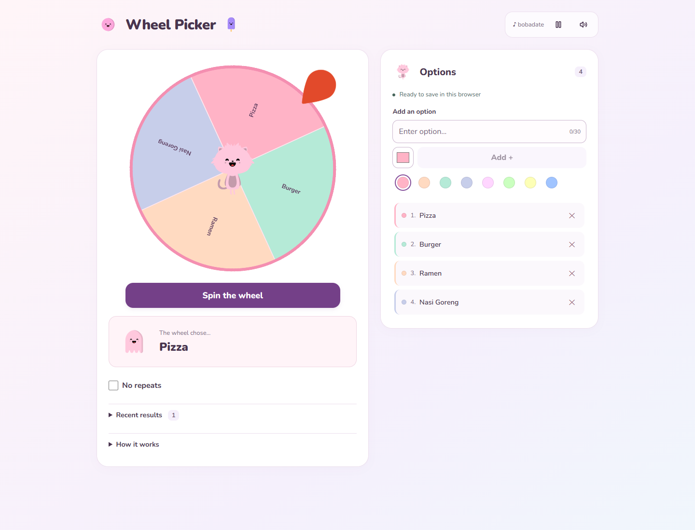
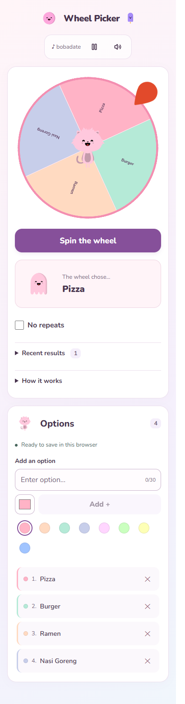

# Kawaii Random Wheel Picker

A pastel random picker built with React 18 and Vite. Add your own options, spin the wheel, and hear the celebration when a winner is revealed.

[Open the live app](https://danarq.id/KawaiRandomWheelPicker/)

## Screenshots

Desktop view after a completed spin:



<details>
<summary>Mobile screenshot</summary>



</details>

## Run locally

```bash
npm ci
npm run dev
```

## Checks

```bash
npm test
npm run lint
npm run build
npm run preview
```

## Wheel behavior

- Each entry has an equal chance on every spin. Normal mode allows repeated winners.
- **No repeats** picks every name once before starting a new cycle. Existing duplicate names count as the same name.
- The winner is captured when the spin starts. Editing and mode changes are disabled during the animation.
- Long lists use numbered wheel labels matching the full names in Options.
- Recent results holds the last 20 winners. Clear removes history only; refreshing or changing options resets the result, history, mode, and cycle.
- New duplicate names are rejected after normalizing capitalization, whitespace, and Unicode presentation. Older saved duplicates display a warning without being removed automatically.

## Storage and synchronization

- Options and colors are saved in localStorage for the current browser/profile, including an empty list. There is no cross-device synchronization.
- Tabs in the same browser/profile synchronize automatically. Incoming changes during a spin wait until it finishes, then reset the result and cycle.
- Before saving, the app checks the stored revision. Conflicting edits reload the latest list and ask you to retry while preserving the input text.
- Web Locks prevent simultaneous tab writes. Use a browser supporting Web Locks over HTTPS or localhost, with all tabs running the latest app version.
- Read/write failures display a warning. Unreadable data is not automatically overwritten, and failed edits are not applied.

## Audio, layout, and accessibility

- Sound effects share a Web Audio context. Tapping **Spin the wheel** resumes the context and preloads the click, completion, and meow effects before the delayed winner callback runs. This addresses iPhone Safari's user-interaction requirement for audio.
- Repeated effects reuse decoded audio but create fresh playback sources. A later tap retries interrupted audio or failed sound downloads.
- Background music tries autoplay, then retries on the first eligible click or key press if blocked. The Play button remains available if playback is still blocked.
- Music pause and volume preferences are stored separately from options. A browser autoplay rejection does not save a Pause preference. Music controls affect background music; wheel effects remain separate.
- The wheel and Options appear side by side from 960 px, with a single column below that width. Music controls are in the header.
- Recent results and How it works are collapsible. History starts collapsed and displays its result count.
- Save status distinguishes saving, saved, synced, conflict, and error. Conflict/error messages remain until another action or recovery.
- Enter adds an option and returns focus to the input after success. Escape or an outside click closes the volume popover.
- Touch controls are at least 44 px, keyboard focus is visible, and reduced motion disables decorative animations while preserving the wheel animation.

Audio verification includes automated regression tests and desktop Chromium playback measurements. Physical iPhone/Safari playback has not yet been tested.

## Deploy to GitHub Pages

```bash
npm run deploy
```

The predeploy script builds the app, then `gh-pages` publishes `dist` to the `gh-pages` branch. GitHub Pages serves that branch at `/`, with the app's Vite base set to `/KawaiRandomWheelPicker/`. Git credentials with push access are required.

## Main packages

- React 18 and React DOM
- Vite with the React plugin
- [react-custom-roulette](https://www.npmjs.com/package/react-custom-roulette) for the wheel
- [react-kawaii](https://www.npmjs.com/package/react-kawaii) for character illustrations
- Lucide React for icons
